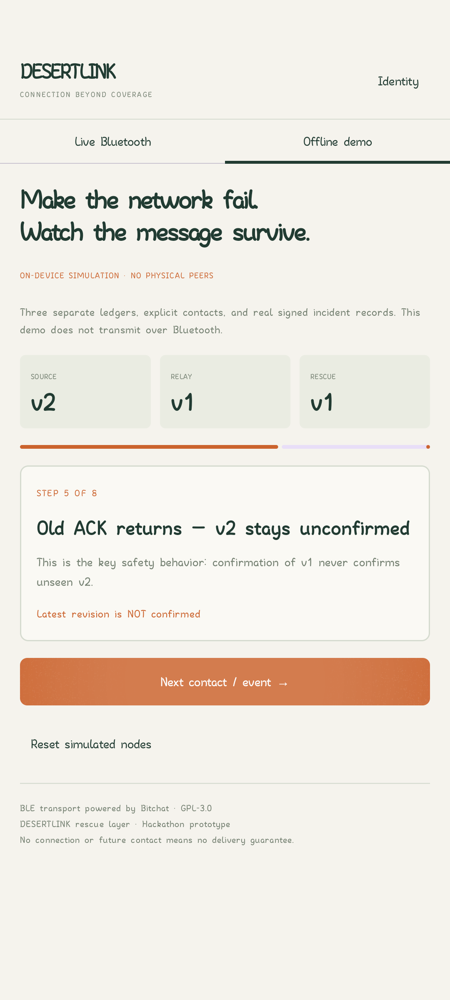
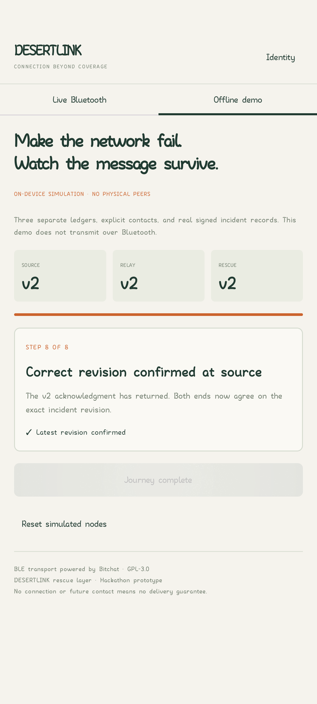
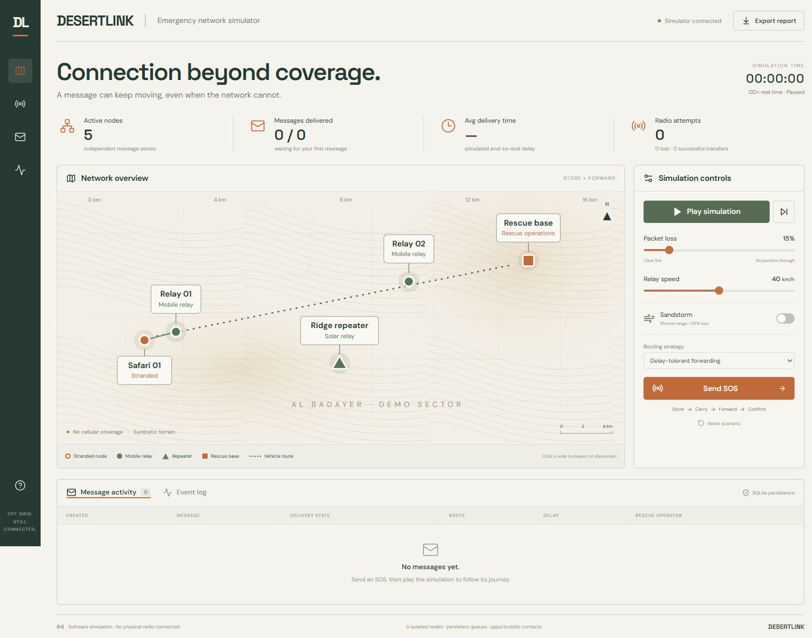
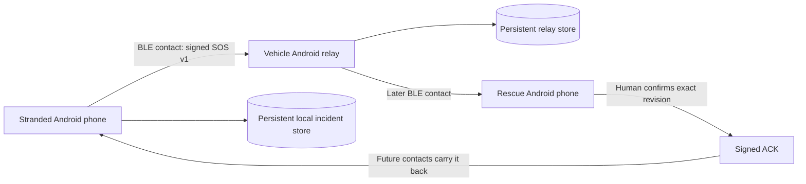

<p align="center">
  
</p>

<p align="center"><strong>Emergency messages that travel with people, even when the network cannot.</strong></p>
<p align="center">Android · Bluetooth Low Energy · Persistent incidents · Version-specific confirmation</p>
<p align="center"><strong><a href="https://desertlink.vercel.app">Open the live interactive demo</a></strong> · <a href="https://github.com/f20230006-sketch/DesertLink/releases/tag/v0.2.0">Download Android APK</a></p>
<p align="center">
  <a href="#try-it">Try it</a> · <a href="#the-demo">Watch the demo</a> · <a href="#what-we-added">Our contribution</a> · <a href="#build-the-android-app">Build Android</a> · <a href="#honest-boundaries">Limitations</a>
</p>

---

## The problem

A safari vehicle breaks down outside mobile coverage. A passing vehicle collects its SOS and drives toward rescue base. After that vehicle leaves, the stranded driver updates the incident: **the situation has become a medical emergency**.

The old SOS can still reach base first. An acknowledgment of that old message must never tell the driver that rescue has seen the new urgency.

**DESERTLINK adds revision-aware rescue incidents above an existing BLE mesh transport.** It preserves messages during disconnection and makes confirmation refer to the exact revision received.

## What works today

| Component | Current state |
| --- | --- |
| Android APK | Built and installed on a physical Android phone |
| Local incident storage | Persistent signed SOS records and revision watermarks |
| Revision-specific confirmation | Signed operator ACKs; trusted rescue fingerprint required for trusted confirmation |
| Android offline demo | Three isolated simulated ledgers with explicit contact events |
| Physical BLE transport | Integrated from Bitchat; requires two phones for an end-to-end radio test |
| Desktop network simulator | Working map, mobile relays, packet loss, expiry, route tracing, and returning ACKs |
| Raspberry Pi | Not required; outside the current scope |

## Download the Android app

**[Get the v0.2.0 Android prerelease](https://github.com/f20230006-sketch/DesertLink/releases/tag/v0.2.0)** · ARM64 APK · Development-signed hackathon prototype.

## The demo

<p align="center">
  <a href="docs/assets/desertlink-demo.mp4"></a>
</p>

**[Watch the 32-second Android walkthrough](docs/assets/desertlink-demo.mp4)** · A silent walkthrough assembled from real app-only phone captures of the simulated scenario. It demonstrates protocol states, not a physical BLE exchange. Captures show an early build; the current APK bundles DM Sans for consistent typography.

The Android **Offline demo** tab runs the protocol locally with three independent ledgers. It is explicitly labeled as a simulation. It does not invent physical peers or claim a radio transfer.

1. **Store:** the stranded phone saves SOS v1.
2. **Carry:** a simulated vehicle collects v1 and leaves range.
3. **Update:** the source creates v2 while isolated; the vehicle still has v1.
4. **Deliver:** rescue base receives and acknowledges v1.
5. **Reject false confidence:** the old ACK returns, but v2 remains unconfirmed.
6. **Reconcile:** the relay encounters the source and learns v2.
7. **Confirm:** base receives v2 and signs a new acknowledgment.
8. **Return:** that exact acknowledgment reaches the source.

<p align="center">
  
  
</p>

The browser simulator shows the larger topology and controlled failures:



## What we added

BLE mesh and delay-tolerant networking are established techniques. We do not claim to have invented them.

Our application layer focuses on **which emergency revision a rescue operator actually confirmed**:

- Stable incident IDs and increasing revisions.
- Durable local storage while no device is nearby.
- Local reconciliation: a node replaces an obsolete payload only after receiving a valid newer revision.
- Revision watermarks that prevent older messages from returning after payload expiry.
- Separate destination receipts and human acknowledgments.
- Signed incident records and ACKs using an Android Keystore-backed ECDSA identity.
- Explicit rescue fingerprint trust: choosing the role “rescue” does not establish authority.
- A reproducible isolated-update demo that exercises the same protocol and ledger code.

No node can know about an update it has never encountered. The UI communicates that uncertainty.

## Try it : https://desertlink.vercel.app/

### On one Android phone

Open **DESERTLINK → Offline demo → Start the demo**, then advance each contact/event. Watch the source, relay, and base revision numbers diverge and eventually agree. Step 5 is the key moment: the old ACK must leave the latest revision unconfirmed.

The **Live Bluetooth** tab creates real locally persisted SOS records. With no nearby peer, the app honestly shows destination unconfirmed.

### Between two Android phones

1. Install the same DESERTLINK APK on both phones and finish Bluetooth onboarding.
2. Keep Bluetooth on. Turn mobile data and Wi-Fi off to demonstrate the offline path. Keep both apps visible for the initial test.
3. Set the second phone’s role to **Rescue** in **Identity**.
4. Compare its full signing fingerprint directly with the operator, then enter it as the first phone’s trusted rescue fingerprint.
5. Create an SOS on the first phone. Bring the phones into range and wait for discovery and gossip.
6. On the rescue phone, explicitly confirm the received revision. Wait for the signed ACK to return.
7. Separate the devices or disable Bluetooth, create an update, and reconnect. The newer revision must remain unconfirmed until its own ACK returns.

With one available phone, the physical two-device exchange remains **unverified**. Do not present the local simulation as a measured BLE mesh result.

### Browser simulator

Requires Python 3.10+ and Node.js 20.19+.

```powershell
python -m pip install -r requirements.txt
npm ci
npm run build
python -m uvicorn backend.app:app --host 127.0.0.1 --port 8000
```

Open [localhost:8000](http://127.0.0.1:8000). Send an SOS, play the simulation, and acknowledge it at rescue base. Try 100% packet loss, stopped vehicles, disconnected nodes, or direct-only routing. Export the JSON report to inspect recorded outcomes.

For frontend development, run `npm run dev` alongside the Python server. Vite proxies API and WebSocket traffic.

## Build the Android app

The Android directory is a Bitchat-derived source tree. It uses the SDK, Kotlin, Gradle, and JDK versions declared in its build files. **JDK 21 is required.** Install the Android SDK and set `ANDROID_HOME` or use an untracked `local.properties` file.

```powershell
cd android
.\gradlew.bat :app:assembleDebug
.\gradlew.bat :app:testDebugUnitTest --tests 'com.bitchat.android.desertlink.*'
```

On macOS/Linux, use `./gradlew`.

For the Poco F5 and other ARM64 phones, the debug artifact is:

```text
android/app/build/outputs/apk/debug/app-arm64-v8a-debug.apk
```

```powershell
adb install -r android/app/build/outputs/apk/debug/app-arm64-v8a-debug.apk
```

App ID: `org.desertlink.rescue`. This is a development-signed hackathon build, not a production emergency service. Install only a build from source you trust.

## Architecture



| Layer | Implementation |
| --- | --- |
| Android UI | Kotlin + Jetpack Compose |
| Physical transport | Upstream Bitchat BLE discovery and mesh messaging |
| Rescue envelope | `DL1:` application payload; unchanged underlying Bitchat wire protocol |
| Identity | Android Keystore EC P-256 key; SHA-256 public-key fingerprint |
| Payload authenticity | SHA256withECDSA signatures verified at every admitting node |
| Persistence | App-private local incident ledger and revision watermarks |
| Forwarding | Bounded cyclic gossip of unexpired records while BLE peers are available |
| Browser simulator | React + TypeScript, FastAPI + WebSockets, SQLite node inventories |

The rescue store and forwarding scheduler now belong to a process-wide runtime and dedicated Bluetooth foreground service. Activity recreation does not own or cancel them. Android and vendor battery restrictions can still stop background operation, which needs physical-device validation.

## Validation

```powershell
python -m unittest discover -s tests -v
npm run build
```

The Python suite covers partition delivery, returning ACKs, complete packet loss and recovery, expiry, node disconnection, restart persistence, priority, duplicate suppression, and isolated revision updates.

The Android protocol suite covers signature tampering, isolated revisions, trusted identity checks, stale ACK rejection, expiry watermarks, malformed envelopes, and the eight-step demo. Device UI tests are in the Android source tree.

Android lint reports inherited findings and is **not clean**. A successful Gradle task is not evidence that those findings have been resolved.

## Honest boundaries

- **BLE is local contact communication.** Physical movement bridges gaps over time; software does not create radio coverage across empty desert.
- **No future contact means no delivery guarantee.** Sending or relaying is not destination or human confirmation.
- **SOS payloads are public.** The rescue envelope is signed, not end-to-end encrypted. Use synthetic details in the prototype.
- **No real GPS in the incident screen.** Current incident text is entered manually. The browser map and locations are illustrative.
- **Power and range are not field measurements.** The simulator’s kilometer ranges are assumptions and do not describe the phone BLE radio.
- **This is a prototype, not a life-safety system.** Operator confirmation does not mean rescue has been dispatched.

See [the deployment proposal](DEPLOYMENT.md) for convoy operations, power, environmental protection, and the current demonstration boundary.

## Validation status

- v0.2.0 APK builds, installs, and opens on a physical phone.
- 14 focused rescue/operations/updater JVM tests pass; 5 backup tests pass.
- 8 Python simulator tests pass.
- The broad Android suite reported 25 failures among 860 tests, with 4 skipped, before a backup-contract fix. A baseline comparison has not established which remaining failures predate DESERTLINK changes.
- Automated phone UI tests are blocked at activity launch / attachment; a full operational device-test pass is not claimed.
- Upstream lint findings remain; lint is not clean.
- Physical phone-to-phone BLE delivery remains unverified until a second phone or a suitable virtual-radio setup is available.

## Offline messaging and online app updates

Rescue incidents travel through **Bluetooth only**. The dedicated DESERTLINK launcher does not start Bitchat’s Nostr, Tor, or Wi-Fi transports. Mobile data and Wi-Fi can be off during rescue messaging.

Internet is optional and used by a separate updater:

1. Check the public GitHub releases endpoint when online, at most every six hours while the app process is alive.
2. Download manually, or enable optional automatic Wi-Fi downloads.
3. Check HTTPS source, package name, newer version code, and the same signing certificate as the installed app. Compare GitHub’s SHA-256 digest when provided.
4. Ask the user to approve installation through Android. An ordinary app cannot promise silent installation.

Offline checks wait quietly. Update requests contain no incident payloads, peer identifiers, or location. Updates must use the same signing key; production signing and a CI signing-secret workflow are not configured. The first move from v0.1.0 to v0.2.0 is a manual APK installation because v0.1.0 has no updater.

## Open-source foundation & license

DESERTLINK Android builds on [permissionlesstech/bitchat-android](https://github.com/permissionlesstech/bitchat-android), checked out at `0594b60ff4adc4e8ed5dbc07ec163d0aedfc1607`.

Credit the Bitchat contributors for BLE discovery, mesh transport, routing infrastructure, foreground-service support, and their existing messaging work. DESERTLINK adds its rescue-specific screen, signed incident protocol, revision ledger, trust checks, and demo.

The upstream Android `LICENSE.md` contains **GPL-3.0**. This repository preserves that license and upstream notices. See [LICENSE](LICENSE), [upstream Android README](android/README.md), and [DESERTLINK Android notes](android/DESERTLINK.md). Any redistribution of a derivative APK must follow the applicable license terms and provide corresponding source.

---

**DESERTLINK — store it, carry it, forward it, confirm the right revision.**

## Web deployment mode

**Live demo: [desertlink.vercel.app](https://desertlink.vercel.app)** — Send SOS, advance the simulation until rescue receives it, click **Acknowledge**, and continue until **Confirmed at source**. Packet loss can delay both journeys.

Use **Start guided demo** for a ready-made SOS, or **Send SOS** to enter your own text. The incident card above the map shows the payload, revision, illustrative coordinates, expiry, current copy holders, and acknowledgment stages. Orange arrows mark recent packet transfers; green lines mean radio contact is possible. The latest transfer remains readable in the incident card after an arrow disappears.

**Testing controls:** relay speed changes movement only when you play or step time. At 40 km/h, one 60-second step moves a vehicle about 0.67 km. Delivery delay is an observed arrival time, not a setting; changing speed does not rewrite earlier results. For a fair comparison, reset, set loss to 0%, choose a speed, send the same SOS, and repeat from reset at another speed. Contact timing and packet loss can also affect arrival.

**Export report** becomes available after sending an SOS. Its JSON includes incident values, per-node packet contents, configuration, metrics, and the latest 200 events, including control changes and directional transfers. Each visitor's scenario is local to their browser.

Vercel builds with `npm run build:demo`. The hosted site runs the contact simulator in each visitor’s browser, with isolated node queues, local persistence, and no Python server or WebSocket dependency. It is a software simulation, not an internet bridge for Android SOS messages. Local Python/SQLite mode remains available with `npm run build`.

Production is deployed through the Vercel CLI. Automatic deployment from GitHub pushes is not configured yet.

```powershell
npm run test:browser
npm run build:demo
```

[Full project context and remaining work](PROJECT_CONTEXT.md)
